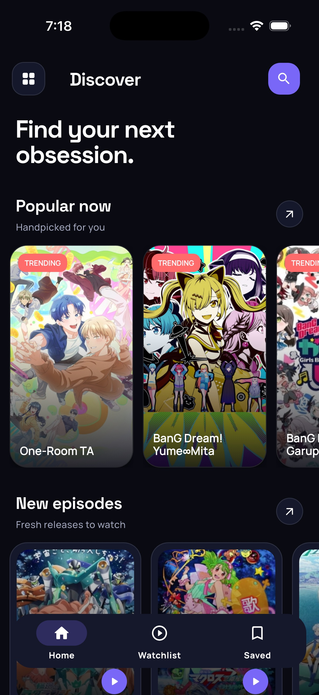
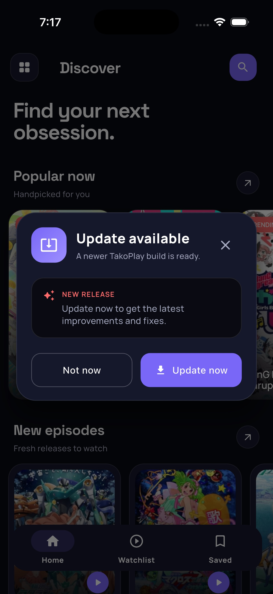

# Tako Play

<p align="center"><a href="https://github.com/kaungsatthe1n/Tako-Play"></a></p>

<h2 align="center" ><span style="font-size:100%"> A Mobile App to Watch Anime With No ADS !! .  </span><h3/>

<h3 align ="center"> Please Do not put Tako-Play to Google PlayStore or Any other Store !! <h3/>

## Download App

- #### Android : [Download TakoPlay.apk](https://github.com/kaungsatthe1n/Tako-Play/releases/download/v1.5.1/TakoPlay-v1.5.1.apk)

- #### IOS : _Coming soon ..._

## Screenshots

<p align="center">
  
  
</p>

<p align="center"><em>Current Discover and update-prompt designs on iPhone.</em></p>

## Brief About App

Parsing require data from website and serve anime with Ads FREE :bangbang:

### Features

- Popular Animes
- Recently Added Animes
- Movies
- Search Anime
- Bookmark Animes
- Webview Player Support
- No Annoying Ads
- Auto Video Quality Detect
- Update Support

## Clone Repository

Open Your `Terminal` and `Paste`

```bash
$ git clone https://github.com/kaungsatthe1n/Tako-Play.git
```

## Build Setup

```bash

# install dependencies

$ flutter pub get
```

## Testing

```bash
# Unit and widget tests
$ flutter test

# Named end-to-end flows on a connected simulator or device
$ flutter test integration_test/home_catalog_detail_flow_test.dart -d <device-id>
$ flutter test integration_test/search_flow_test.dart -d <device-id>
$ flutter test integration_test/library_flow_test.dart -d <device-id>
$ flutter test integration_test/watchlist_flow_test.dart -d <device-id>
$ flutter test integration_test/episode_error_and_recent_flow_test.dart -d <device-id>
$ flutter test integration_test/detail_error_recovery_flow_test.dart -d <device-id>
$ flutter test integration_test/drawer_preferences_and_about_flow_test.dart -d <device-id>
```

The E2E flows use local catalog fixtures, so they validate app behavior without
depending on changing third-party catalog or player pages.

## Found This Project Useful ?

You can leave a star :star: at the top-right corner of this repository.
