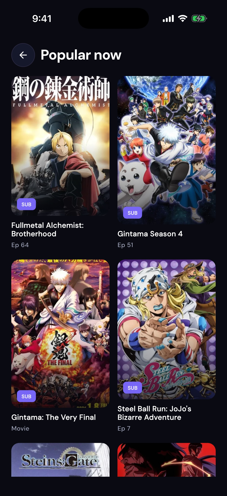
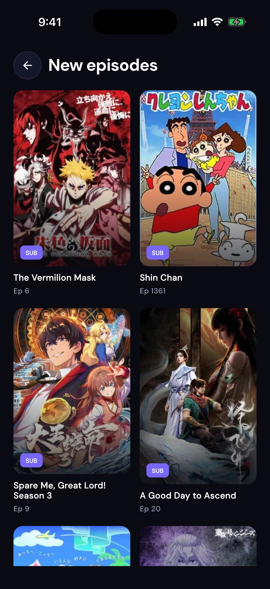
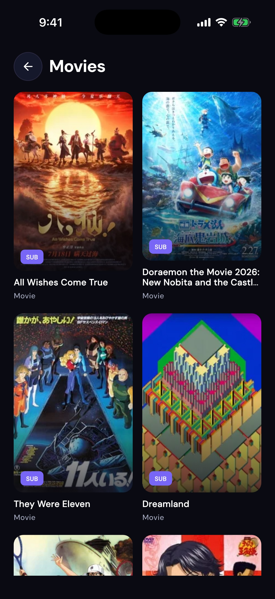
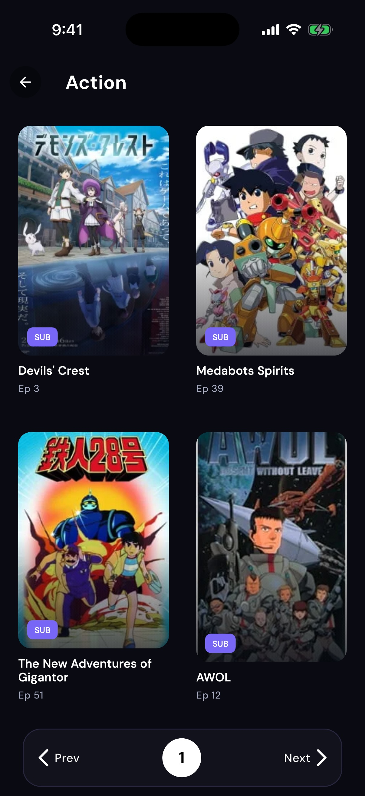

# TakoPlay

TakoPlay is an educational Flutter app for browsing an anime catalog, finding
titles, saving favourites, tracking recently opened episodes, and handing an
episode to an external web player. It does not host or provide video content.

## Download

[](https://github.com/kaungsatthe1n/Tako-Play/releases/latest/download/TakoPlay-release.apk)
[](https://github.com/kaungsatthe1n/Tako-Play/releases/latest/download/TakoPlay-release.ipa)
[](altstore://source?url=https://github.com/kaungsatthe1n/Tako-Play/releases/latest/download/apps.json)

| Platform | File | Requirement |
| :--- | :--- | :--- |
| Android | `TakoPlay-release.apk` | Android phone or tablet |
| iOS (AltStore) | AltStore source | iPhone/iPad, iOS 15+ |
| iOS (Sideloadly) | `TakoPlay-release.ipa` | iPhone/iPad, iOS 15+, PC/Mac |

> [!WARNING]
> **Only download TakoPlay from this GitHub repository.**
> TakoPlay is not published on the Google Play Store, the Apple App Store,
> or any other app store or download site. If you find TakoPlay there, it
> is not from me — it may be outdated, modified, or contain malware. Do
> not install it.

New to iOS sideloading? Follow the [installation manual](#install-on-ios-sideload)
below.

## Screenshots

Updated screenshots captured from the current iPhone 17 simulator build.

| Discover | Saved |
| :---: | :---: |
|  |  |

| Search results | Anime detail: Bleach |
| :---: | :---: |
|  |  |

| Popular titles | New episodes |
| :---: | :---: |
|  |  |

| Movies | Action genre |
| :---: | :---: |
|  |  |

| Movie detail: Bleach: Hell Verse |
| :---: |
|  |

## Features

- Popular, recently added, and movie catalog sections
- Search with recent-query history
- Episode lists, saved titles, and watchlist progress
- Genre browsing and pagination
- Native HLS playback in BetterPlayer, with source-provided player fallbacks
- Player-type and preferred-quality settings
- Release update checks

### Next episode in the native player

Near episode end, BetterPlayer shows **Play next** and **Keep watching**.
The next source, request headers and up to three standalone subtitle files are
prepared 60 seconds before the prompt. Selecting Play next reuses the player and
updates history; nothing advances automatically. The final episode has no
prompt.
Signed sources older than two minutes are resolved again when selected.

Ending timing uses `endingStartSeconds` from a configured playback resolver when
available. Otherwise the app searches
[AniList](https://docs.anilist.co/guide/graphql/queries/media) for an
unambiguous exact title/alias match, then requests opening and ending intervals
from [AniSkip](https://github.com/aniskip/aniskip-api). The request includes the
title or MAL ID, episode number and video duration; no account is required.
Unknown titles, specials, season-number mismatches, unavailable metadata and
duration mismatches fall back to a prompt in the last 30 seconds. This fallback
does not detect the ending song. Episodes of 30 seconds or less prompt at the
end.

The player also looks up a recorded opening interval and shows **Skip intro**
only while that interval is playing. It seeks to the interval's end when tapped;
missing or mismatched opening data leaves the button hidden.

Prefetch failures leave the current video playing and allow an explicit retry.
Dynamic sources use the existing muted extraction WebView. Browser-player mode
does not have this overlay. Newly stored history includes the title's catalog URL
so the episode queue can be restored; older entries without a recoverable title
URL gain the feature when opened again from the episode list.

## Requirements

- Flutter SDK 3.32 or later
- Xcode for iOS simulator builds
- Android Studio and an Android SDK for Android builds

## Get started

```bash
git clone https://github.com/kaungsatthe1n/Tako-Play.git
cd Tako-Play
flutter pub get
flutter run
```

## Install on Android

1. Download `TakoPlay-release.apk` from the button above.
2. Open the file on your device and allow **Install unknown apps** for your
   browser or file manager if Android asks.
3. Tap **Install**, then open TakoPlay.

## Install on iOS (sideload)

TakoPlay is not on the App Store, so iOS users install the IPA with a
sideloading tool. The IPA is unsigned on purpose: the tool signs it with
**your own Apple ID** on your device. No developer account is needed.

Before you start:

- iPhone or iPad with iOS 15.0 or later
- A free Apple ID
- AltStore **or** Sideloadly (choose one)

### Option A: AltStore (recommended)

AltStore refreshes the app automatically in the background, so it does not
expire after 7 days.

1. Install AltStore on your iPhone from
   [altstore.io](https://altstore.io) (follow its guide; it needs a PC/Mac
   on the same Wi-Fi for the first setup).
2. On your iPhone, tap the **AltStore - Add Source** button above, or open
   AltStore, go to **Sources**, tap **+**, and paste this URL:

   ```text
   https://github.com/kaungsatthe1n/Tako-Play/releases/latest/download/apps.json
   ```

3. Go to **Browse**, find **TakoPlay**, and tap **Install**.
4. To update later, open AltStore and tap **Update** when a new version
   appears.

### Option B: Sideloadly

1. Download and install Sideloadly from
   [sideloadly.io](https://sideloadly.io) on your PC/Mac.
2. Download `TakoPlay-release.ipa` from the button above.
3. Connect your iPhone with a cable (or same Wi-Fi) and open Sideloadly.
4. Drag the IPA into Sideloadly, enter your Apple ID, and click **Start**.
5. On the iPhone, go to **Settings > General > VPN & Device Management**,
   tap your Apple ID, and choose **Trust**.
6. Open TakoPlay.

### Good to know

| Topic | What to expect |
| :--- | :--- |
| 7-day expiry | Lasts 7 days. AltStore auto-refreshes; Sideloadly: reinstall. |
| App limit | A free Apple ID allows at most 3 sideloaded apps. |
| Untrusted Developer | Trust: **Settings > General > VPN & Device Mgmt.** |
| Won't open after a week | Signature expired: refresh or reinstall to fix it. |
| Updates | AltStore: in-app. Sideloadly: download and reinstall. |

## License

The current source is distributed under the [PolyForm Noncommercial License 1.0.0](LICENSE).
You may use, modify, and share it for noncommercial purposes. Commercial use requires
separate permission from the copyright holders.

Previously published versions were released under the MIT License. This change does
not revoke the permissions granted for those versions.
